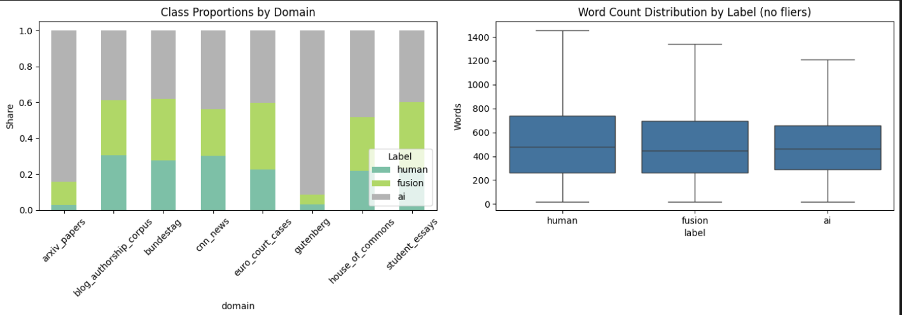

## IMPORTANT

The final commit to code was made before 2026-11-24 which is according to the rules. On 2026-11-24 commits only affected report.md and images/ and didnt make any other changes.

Report takes 2 pages: https://docs.google.com/document/d/15hI6DnefJrq667XW_fbzVMDrNu2iXyio4eV9YY6EbE8

## Introduction

In this work different approaches to AI generated text detection were tested. Simple Vectorizers with ML models, were used, as well as Transformers like mDeBERTa-v3-base. Handling texts longer than transformer can process was done. Different Models used. Perplexity and open weights training also helped. This all was combined with Ensemble. Results were analyzed with xAi approach

## Timeline

### EDA

Kaggle preview has shown that data is clean.

EDA has shown the disbalance in labels(ai-44% fusion-30% human-24%) and languages(EN-80% DE - 20%) distribution. In arxiv_papers and guttenberg sources was AI disbalance. More than half of texts are longer than 512 tokens. Text has useful information in characters like quotes, apostrophes and so on which helps differentiate human ai and fusion. For this reason text was not cleaned aggresivelly.

human-fusion pairs were not labeled, so was used UNION FIND with preffix=100 suffix=80 found experimentally.

### Baseline

Was used Word TF-IDF and char_wb TF-IDF. adding metadata had no meaningful effect. Confusion matrix has shown ai is labeled very good. Main challenge was to distinguish human and fusion.

### Transformer

mdeberta-v3-base was used. It processed 512 tokens, first 256 and last 256, but missed fusion in the middle.

### 4 other approaches

+ Longer Text: used mdeberta-1024 to process beginning, middle and end of a text.

+ Perplexity: used Qwen2.5-0.5B to measure 40 features, but in combination with next approach it didnt make meaningful change

+ Decoder LLM with LORA: Qwen2.5-1.5B was frozen but adapters and head trained in FP32 on 60k lines.

+ Ensemble: used Nested 5-Fold CV based on fold-0 (validation fold). It Connected all previous approaches, including mdeberta-v3-base and baseline

Important tabble

--- Ensemble v3 by domain ---
                domain     n  err  macro_f1   f1_H   f1_F   f1_A
             gutenberg  1529   17    0.9184 0.8819 0.8741 0.9993
blog_authorship_corpus  8241  553    0.9278 0.8982 0.8927 0.9924
          arxiv_papers  2850   15    0.9631 0.9112 0.9780 1.0000
             bundestag 10230  178    0.9815 0.9708 0.9758 0.9978
        student_essays 11039  167    0.9828 0.9697 0.9800 0.9987
      euro_court_cases  5575   70    0.9851 0.9723 0.9830 1.0000
      house_of_commons  6358   49    0.9900 0.9826 0.9879 0.9995
              cnn_news  8768   26    0.9966 0.9955 0.9947 0.9995

## Conclusion

In this homework different approaches were tried and combined in ensemble. The score might have been improved by training Qwen2.5-1.5B on more data or by adding other Backbones like XLM-R.
